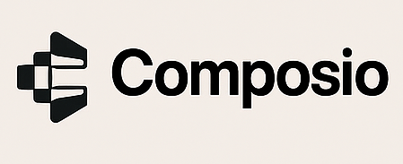
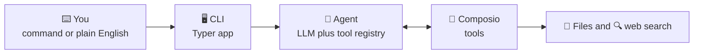

<div align="center">

# Agentic CLI

**A command-line agent that understands plain English, works with your files and searches the web.**

Built twice, once with Claude Code and once with Gemini CLI,<br>
both powered by the Composio platform.

<br>

[](https://composio.dev/)

<br>


[**Demo**](#demo) · [**Features**](#features) · [**How it works**](#how-it-works) · [**Getting started**](#getting-started) · [**Commands**](#commands) · [**Project structure**](#project-structure)

</div>

<br>

> [!NOTE]
> This repo holds two separate builds of the same idea, made to compare coding agents. Each one lives in its own folder and has its own setup. Pick one.

<a id="demo"></a>

## 🎬 Demo

**Claude Code build**

https://github.com/user-attachments/assets/3344c263-0c94-4435-aee8-c3c404fcf922

**Gemini CLI build**

https://github.com/user-attachments/assets/07c8ed9e-55a0-4761-8ce6-2a13fee4e076

<a id="features"></a>

## ✨ Features

| Feature | What you get |
|:---|:---|
| 🧠 **Natural language** | Say what you want, like "list Python files" or "create a hello.py file", and the agent picks the right tool. |
| 📁 **File operations** | List, read, create, write and delete files and directories, with permission checks. |
| 🔍 **Web search** | Search the web and get structured results. The Gemini CLI build uses SerpAPI. |
| 🛠️ **Tool registry** | Tools are registered with a name, category, parameters and examples. Add your own. |
| 🎨 **Rich terminal UI** | Syntax-highlighted code, tables for directory listings and clear status messages. |
| 🛡️ **Safety** | Inputs are validated and file actions are guarded before they run. |

<a id="how-it-works"></a>

## ⚙️ How it works



1. **Ask:** use a direct command like `ls`, or describe the task with `run`.
2. **Plan:** the agent sends your request and the tool list to the model, which picks a tool and its parameters.
3. **Act:** the tool runs through Composio, and the result is printed with Rich formatting.

<a id="getting-started"></a>

## 🚀 Getting started

**Requirements:** Python 3.9+, a [Composio API key](https://app.composio.dev/developers), and an [OpenAI API key](https://platform.openai.com/api-keys). A [SerpAPI key](https://serpapi.com/) is optional and used for web search.

**1. Clone the repo**

```bash
git clone https://github.com/DevloperHS/agentic_cli_tool.git
cd agentic_cli_tool
```

**2. Pick a build and install it**

```bash
cd claude-code/composio-cli-agent     # or: cd gemini-cli/composio-cli-agent
python -m venv venv
source venv/bin/activate              # Windows: venv\Scripts\activate
pip install -r requirements.txt
```

**3. Add your keys**

```bash
cp .env.example .env
```

```env
COMPOSIO_API_KEY=your_composio_api_key_here
OPENAI_API_KEY=your_openai_api_key_here
SERPAPI_API_KEY=your_serpapi_api_key_here   # optional, web search
```

> [!TIP]
> Check the `.env.example` in the build you chose. The variable names differ slightly between the two (for example `SERPAPI_KEY` in the Gemini CLI build).

**4. Check your setup and try it**

```bash
./composio-agent setup                       # Gemini CLI build
./composio-agent run "list Python files"
```

In the Claude Code build, run commands as `python -m cli.main <command>`.

<a id="commands"></a>

## 💻 Commands

| Command | What it does | Example |
|:---|:---|:---|
| `run` | Run a plain-English request | `run "read the contents of config.txt"` |
| `ls` | List directory contents | `ls /path/to/dir` |
| `cat` | Read a file | `cat script.py` |
| `create` | Create a file | `create notes.txt --content "Hello"` |
| `rm` | Delete a file or directory | `rm old.txt` |
| `search` | Search the web | `search "Python best practices" --max 3` |
| `tools` | List available tools | `tools --search file` |
| `status` | Show agent status | `status` |
| `help-tool` | Help for one tool | `help-tool read_file` |

<details>
<summary><b>Tests</b></summary>

<br>

```bash
python -m pytest tests/
python -m pytest --cov=agent --cov=cli --cov=core tests/
```

</details>

<details>
<summary><b>Add your own tool</b></summary>

<br>

1. Register it in `agent/tools.py` with a name, category, description and parameters.
2. Implement it as a method in `agent/agent.py`.
3. Add a CLI command in `cli/main.py` if you want a direct shortcut.

</details>

<a id="project-structure"></a>

## 🗂️ Project structure

```text
agentic_cli_tool/
├── claude-code/
│   └── composio-cli-agent/     # Build made with Claude Code
│       ├── agent/              # Agent class and tool registry
│       ├── cli/                # Typer app and command processors
│       ├── core/               # Utilities
│       ├── scripts/            # Setup helper
│       └── tests/
├── gemini-cli/
│   └── composio-cli-agent/     # Build made with Gemini CLI (adds SerpAPI search)
│       ├── agent/  cli/  core/  config/  scripts/  tests/
│       └── INSTALL.md          # Longer install guide
└── imgs/                       # Images used in this README
```

Each build has its own README with more detail:
[Claude Code build](claude-code/composio-cli-agent/README.md) · [Gemini CLI build](gemini-cli/composio-cli-agent/README.md)

## 📄 License

[GNU GPL v3](LICENSE).

<div align="center">
<br>
<sub>Say it. Run it.</sub>
</div>
